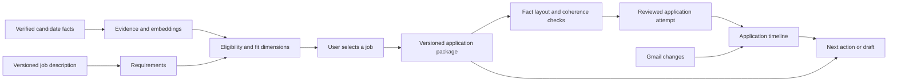

# JobPilot automation and intelligence review

Date: 1 November 2026. Reviewed revision: `402e713483947a8cec5b6573283c50e3e4a3b44d`, following the merge of `improve/r0-r1-correctness`. Comparison baseline: `8c5123a09313fd9eedac60cca1c17c4a0c0a8c8d`.

The changes materially improve document selection, review acknowledgments, startup behavior, and the distinction between preparation and submission. Keep these improvements. The next priorities are reliable Gmail ingestion, persistent application identity, and factual consistency across generated materials. More autonomous browser behavior would currently amplify unresolved errors.

The best product opportunity is a coherent application workspace: one verified candidate profile, a versioned package for each application, and a timeline that incorporates recruiter correspondence. That design can reduce repeated inference while making CVs, letters, form answers, and follow-ups more consistent.

This review supplements the [original software review](2026-11-01-software-review.md) and [improvement plan](2026-11-01-improvement-plan.md). Findings below describe current behavior; the later designs are proposals. No application code was changed for this review.

Navigate to [change assessment](#what-improved-and-what-remains-open), [findings](#current-findings), [CV coherence](#cv-innovation-through-shared-facts-and-application-packages), [token economy](#token-and-latency-economy), [automation](#automation-that-adds-value-without-multiplying-fragile-steps), [Gmail](#gmail-as-an-application-timeline), or [delivery sequence](#recommended-delivery-sequence).

## What improved and what remains open

| Earlier finding | Assessment at the new revision |
| --- | --- |
| F01 wrong job and document association | Addressed: `StoredMatch` carries the match and its corresponding job through assessment and generation. Counts now distinguish persisted artifacts from selected jobs. |
| F02 unproven submission success | Improved and contained: typed outcomes, destination inspection, and automatic submission disabled by default. The new verifier still has false positives; see R07. |
| F03 corrections ignored before submission | Improved in Tier 1: corrections are applied, read back, and reviewed again. Tier 2 still substitutes requested values for observed values; see R05. |
| F04 local access exposure | Improved: Compose publishes on loopback; Host, Origin, and session checks protect mutation requests and WebSockets. This is a local browser access boundary, not remote account authentication. |
| F05 desktop and container mismatch | Still open: Tier 1 hardcodes a visible browser, and the container does not provide a user-visible browser session. |
| F06 invented CV facts | Still open and reproduced again; see R04. |
| F07 and F22 eligibility and unused settings | Still open: remote-only is a score contribution rather than an exclusion; experience, job-type, and language settings are not all carried through the batch filters. |
| F08 misleading ATS score | Still open: the value is embedding-based skill coverage, not an observed ATS result. An empty extracted job profile still scores 100. |
| F09 regeneration deletes old documents without doing work | Core defect addressed: persisted operations, restart recovery, and publication after generation. Input identity remains incomplete; see R08. |
| F10 and F16 wrong CV choice or uploading LaTeX | Addressed in the selection path: explicit choices, PDF resolution, hashes, and per-attempt copies. Validation and cache dependency gaps remain; see R08–R09. |
| F11 premature or unacknowledged review approval | Improved: HTTP decisions identify a review and revision, reject stale commands, and acknowledge retries. Reviews and decisions still live in process memory. |
| F12 preparation counted as application | Addressed for strategy outcomes: prepared work stays awaiting submission; user attestation is distinct from destination evidence. |
| F13 inconsistent quotas | Configured limit and UTC reservation accounting are now shared. Recruiting-status changes and midnight rollover remain problematic; see R03. |
| F14 and F15 browser ownership and cancellation | Still open: shared strategy browser handles and incomplete cancellation recovery; see R06. |
| F17 pagination after filtering | Still open in the jobs listing. |
| F18 decorative workflow states | Still open: the main strategy work still occurs inside the recording phase. |
| F19 preview can spend inference | Still open: preview invokes the normal scraper before its early exit. |
| F20 and F21 startup and telemetry | Addressed in the inspected paths: migration errors abort startup; dependency telemetry and browser cloud sync are disabled before application imports. |

These changes represent useful early work from the plan, not completion of its R1 acceptance criteria. In particular, factual editing, eligibility, ownership, and operational verification are still unfinished.

The technology choices remain suitable for the local product: retain FastAPI, SvelteKit, SQLite/Alembic, the provider adapters, and LaTeX rendering. Keep the small HTTP Gmail adapter if contract tests cover it. APScheduler can trigger work, but durable operations must own recovery. Constrain browser-use to bounded tasks; use Playwright and explicit code for supported form actions. The reviewed problems do not justify a framework rewrite, microservices, or a new database.

## Validation and evidence

| Check | Earlier review | Current result |
| --- | --- | --- |
| Backend tests, same offline selection | 635 passed, 5 skipped | 734 passed, 5 skipped, 15 warnings |
| Frontend tests | 50 across 5 files | 79 across 9 files |
| Frontend type check with warnings failing | 0 errors, 0 warnings | 0 errors, 0 warnings |
| Frontend production build | Passed | Passed |
| `uv run pyright backend/` | 0 errors, 8 warnings | 0 errors, 8 warnings |
| `uv run ruff check backend tests` | 217 violations | 295 violations |

The backend command was `PYTEST_DISABLE_PLUGIN_AUTOLOAD=1 ANONYMIZED_TELEMETRY=false uv run pytest -p pytest_asyncio.plugin -m 'not integration' --ignore=tests/test_local_provider_smoke.py -q`; it completed in 49.35 seconds. Frontend commands were `npm test`, `npm run check -- --fail-on-warnings`, and `npm run build`. An additional whole-repository `uv run pyright` reports 103 errors and 8 warnings, primarily in tests and scripts; that broader scope is not comparable to the backend-only baseline or CI gate.

Thirteen isolated probes used synthetic content, temporary SQLite databases, and fake external clients. They establish the following local behavior without contacting Gmail, invoking a model, opening a real application form, or sending an application:

| Probe | Observed result |
| --- | --- |
| Two Gmail syncs with the documented `messages.list` response shape | Two list calls and two downloads of the same message; zero history calls; cursor and last-sync timestamp remain null. |
| Message fetch fails with HTTP 503 during a delta | Cursor advances from 100 to 200 although the message was not saved. |
| History cursor returns HTTP 404 | Error propagates; backfill does not restart. |
| Page says “Your application was not successfully submitted. Please try again.” | Classified as `confirmed`. |
| CV replacement changes two years of experience to ten years plus a PhD | Accepted at model confidence 0.99. |
| Change a `.cls` dependency without changing the root CV `.tex` | Cached PDF reused; compiler called only once. |
| A `.pdf` contains only the four bytes `%PDF` | Accepted by the PDF hash validator. |
| Change a confirmed application from applied to interview | Same-day quota changes from 1 to 0; another apply request reaches the strategy. |
| Change CV source after queuing regeneration | Output uses version B while the persisted operation still records version A's input hash. |
| Sender is `hr@greenhouse.io.attacker.example` | Classified as Greenhouse acknowledgment with confidence 0.7. |
| Interleave two applications sharing the auto strategy | First context captures the second browser; first browser is not closed; second is closed twice. |
| Link the same email to the same application twice | Two link rows and two displayed messages. |
| OAuth denial without a code; validate the same state twice | Denial returns HTTP 422; state validates twice. This demonstrates missing state consumption, not reuse of Google's authorization code. |

Local evidence is retained in `/tmp/jobpilot-rereview/`, including `probes.py`, `probes.json`, test/build logs, and `ruff.json`. These are temporary review artifacts, not a new maintained test suite. The main suite exercises migrations through the test setup; the additional probes use the current model schema. Live Google consent, live models, real job-board submission, and a deployed container were not exercised.

## Current findings

P1 means fix before relying on the affected workflow. P2 means important reliability, quality, or efficiency work. Exposure is narrower where a feature is disabled by default.

### R01 Gmail cannot establish its initial history cursor

**P1, reproduced.** `_first_run_ids` reads `page.get("historyId")` from `messages.list`. Google's response schema supplies messages, pagination, and an estimated count; it does not supply a top-level history cursor. The test fake supplies that nonexistent field, which hides the defect. The OAuth profile request already receives a cursor but discards everything except the email address. [Google list response](https://developers.google.com/workspace/gmail/api/reference/rest/v1/users.messages/list), [Google profile response](https://developers.google.com/workspace/gmail/api/reference/rest/v1/users/getProfile).

Consequently, an ordinary first connection can repeatedly backfill the same recent primary-category messages. Deduplication prevents duplicate rows but does not avoid network calls or fix the missing cursor.

Capture a baseline history cursor at the start of the backfill, persist a sync run, download the selected historical messages, and reconcile changes since that baseline before publishing the completed checkpoint. Test a real-shaped response without `historyId`, messages arriving during pagination, and an empty mailbox. Record successful sync time independently of whether new messages were found.

Code: [sync worker](../../backend/gmail/sync.py), `_first_run_ids` at line 128; [OAuth callback](../../backend/api/gmail_auth.py); [test fake](../../tests/test_gmail_sync.py).

### R02 Gmail can permanently skip a transient failure and cannot recover an expired cursor

**P1, reproduced.** `_safe_get` converts every fetch exception into `None`; `_sync_locked` then advances the cursor regardless. A transient failure can disappear behind the new checkpoint with no retry record. Separately, a 404 from `history.list` is not converted into a recovery backfill. Google explicitly requires full synchronization when the history cursor is outside its available range. [Gmail synchronization guide](https://developers.google.com/workspace/gmail/api/guides/sync).

Choose one explicit checkpoint rule: advance only after all required messages are stored or terminally resolved, or atomically persist every outstanding message as durable fetch work before advancing. The latter avoids one troublesome message blocking the entire inbox. Distinguish a deleted message's terminal 404 from an expired history cursor, transient 429/5xx responses, and authorization failure. Use bounded retries with backoff, and show degraded/reconnect-required status instead of a success-shaped sync result.

Code: [sync worker](../../backend/gmail/sync.py), lines 111–125, 144–169; [REST client](../../backend/gmail/client.py).

### R03 Recruiting progress erases submission protection

**P1, reproduced.** Quota accounting includes pending, applied, and needs-verification statuses. Replay protection checks only applied and needs-verification. Moving an application to interview, offer, or rejected does not undo the earlier submission, but those guards stop recognizing it. This will become especially dangerous if Gmail starts updating recruiting status automatically.

Separate persistent submission state from recruiting state. A submitted attempt retains its receipt, submission time, quota consumption, and document package after a recruiter responds. Base replay protection on that persistent identity; provide an explicit reapplication path for a genuinely new requisition or an intentional retry. Also revalidate a reservation at the submission boundary if the review spans UTC midnight: today's submit must not consume only yesterday's reservation.

Acceptance: changing recruiting status never changes submission counts or enables an ordinary duplicate; an attempt reviewed before midnight and submitted afterward obeys the intended daily policy.

Code: [quota policy](../../backend/applier/daily_limit.py), lines 54–56 and 100–105; [apply route](../../backend/api/applications.py), lines 617–637; [application model](../../backend/models/application.py).

### R04 CV safety is still syntactic rather than factual

**P1, reproduced.** The applicator checks model confidence, existence of a source span, and introduction of LaTeX commands. It does not establish that the replacement is true. A section label supplied by a model also does not prove the matched span belongs to that section. The three-change cap limits volume, not the seriousness of a change.

There are additional coherence gaps: assessment-driven editing omits the additional profile context; its prompt does not use the passed job object; cover-letter editing sees a paragraph and a 500-character description excerpt but no shared candidate evidence or selected CV version. The analyzer truncates CV and job text from the front. Requirements or supporting evidence near the end can disappear while the system continues confidently.

Create verified facts with stable IDs and require each factual claim in generated text to reference them. Preserve dates, titles, employers, qualifications, quantities, and claim strength. A related technology is retrieval evidence, not permission to claim proficiency. Until that exists, prioritize selection, ordering, and verbatim reuse; new factual claims require explicit confirmation.

Code: [applicator](../../backend/latex/applicator.py), `apply`; [CV modifier](../../backend/llm/cv_modifier.py); [letter editor](../../backend/llm/cv_editor.py); [job analyzer](../../backend/llm/job_analyzer.py).

### R05 Browser preparation still has submission capabilities

**P1 for agent-driven preparation; code confirmed.** Restricting scripts, file writes, downloads, and uploads is useful, but `click` remains available to preparation agents. Checking the page afterward cannot prevent an early submission, and an unrecognized receipt or unreadable page can escape detection. This applies to assisted preparation as well as the opt-in automatic path.

Tier 2 correction failures are logged, then `fields.update(patches)` records the requested values anyway. A screenshot may be reused when a fresh capture fails. The user can therefore be asked to approve a representation that was not read back. The submit agent also retains field-input and navigation capabilities despite instructions not to change the form. Host-only comparisons cannot distinguish two companies or jobs hosted on the same ATS domain. Taking the last two domain labels produces `*.co.uk` for a UK domain and is not a valid registrable-domain boundary.

For supported forms, code should own typed field operations, approved navigation steps, attachment checks, and the final submit action. Unknown forms should stop for manual completion. Keep general agent submission disabled until this boundary is enforced. Approval must bind the job/form identity, full destination, observed fields, and uploaded document identities; a screenshot is supporting evidence, not a replacement for those checks.

Code: [restricted tools and domains](../../backend/applier/_strategy_common.py); [Tier 2 review](../../backend/applier/auto_apply.py), lines 462–507; [assisted preparation](../../backend/applier/assisted_apply.py); [Tier 1 review](../../backend/applier/form_filler.py), line 255.

### R06 Browser resources and application work remain process-owned

**P1 for overlapping browser attempts, reproduced; recovery gap code confirmed.** The engine still shares strategy instances and copies their mutable `_active_browser` field into an attempt context. The concurrency probe reproduces the previous ownership bug. Cancellation removes review registries and closes a browser but does not reliably finalize the reservation or distinguish before-submit cancellation from possible submission. Application work still awaits a long-running strategy inside the HTTP request, and restart recovery is substantially stronger for document operations than for applications.

Use an attempt-owned strategy and browser, serialize access to a persistent browser profile, persist submission intent before the external action, and recover interrupted work as explicit state. Retry reversible preparation only; reconcile possible submission before any retry. Preserve the new document operation design as a starting point, while adding immutable inputs and bounded retries.

Code: [engine](../../backend/applier/engine.py), constructor, `apply`, and `_dispatch`; [application route](../../backend/api/applications.py), `apply_to_job`.

### R07 The new destination verifier can interpret failure as success

**P1 when automatic submission is enabled, reproduced.** The regex matches “successfully submitted” inside “not successfully submitted.” It also accepts confirmation phrases anywhere in the page body without proving they appeared after this attempt or refer to this job.

Keep the default-off switch. For explicitly supported sites, verify a fresh, job-specific receipt or a tested transition in a known confirmation region. Conflicting or generic text should produce needs-verification. Adding a negation regex fixes the reproduced sentence but does not establish a general verifier. An associated Gmail acknowledgment can later provide independent evidence; a generic ATS sender alone cannot.

Code: [verification](../../backend/applier/verification.py), `classify_page` at line 50; [default gate](../../backend/api/applications.py), lines 640–647.

### R08 New caches and regeneration records do not identify all their inputs

**P2, two cases reproduced.** Base PDF reuse keys only the root `.tex`, although compilation also copies class, style, and image dependencies. Regeneration's input hash excludes profile context, templates/support files, model/provider settings, prompt/schema versions, and tailoring policy. A queued worker rereads mutable current inputs without checking that they match its recorded version. The in-memory analyzer cache is keyed only by job ID despite analysis depending on the CV and job content.

The probe queued CV A, changed the file, and obtained CV B under A's recorded input hash. A changed support file also reused the old PDF.

Define a canonical input manifest and freeze it when accepting work. Either execute that snapshot or mark it superseded and queue a new operation. Hash the complete allowed template dependency set, including supported included source files; explicitly reject unsupported dependency layouts. Include endpoint/model revision and prompt/schema/policy versions in inference keys. Use the manifest for both cache identity and provenance.

Code: [artifact cache](../../backend/latex/artifacts.py), `ensure_base_cv_pdf`; [regeneration](../../backend/latex/regeneration.py), lines 56–61 and 154–180; [analyzer cache](../../backend/latex/pipeline.py), `generate_tailored_cv`.

### R09 PDF identity is stronger than PDF validation

**P2, reproduced.** Hashing and attempt copies make accidental substitution much harder. However, checking the `.pdf` extension and `%PDF` prefix does not establish that a file is readable, has pages, or contains the intended CV. The current function accepts a four-byte file.

Parse the completed artifact with the already-declared PDF library; require a readable, nonempty document and appropriate size/page limits. Separately check extracted text for key candidate facts and document completeness. Hash validation, parsing, factual validation, and visual layout are different checks; none substitutes for all the others. Preserve a failed artifact for diagnosis without publishing it as usable.

Code: [artifact validation](../../backend/latex/artifacts.py), `pdf_sha256` at line 63.

### R10 Gmail scope and worker ownership are inconsistent

**P2, code confirmed.** Initial sync selects only recent `category:primary` messages; history sync has no equivalent relevance/category filter. Important recruiting messages in other categories can be omitted initially, while later changes can ingest unrelated mail. Each forced sync and each scheduled poll constructs a new worker, so its per-account lock is not shared across those entry points. Message uniqueness is checked after downloading, not before, and the UI/API selects the first credential even though OAuth can save several accounts.

Define the supported mailbox scope explicitly and apply it consistently to backfill and changes. Use one application-owned sync coordinator with shared account locks and token-refresh coordination; use durable claims before supporting multiple processes. Deduplicate IDs before fetching. For the current single-account product, enforce one active account or make account selection explicit. Keep account identity in message, thread, cache, and linking keys.

Code: [sync worker](../../backend/gmail/sync.py); [scheduled poll](../../backend/main.py), `_run_gmail_poll`; [manual sync and status](../../backend/api/gmail.py); [Gmail models](../../backend/models/gmail.py).

### R11 OAuth needs a complete connection lifecycle

**P2, reproduced in part.** The callback requires `code` even when Google returns a denial, so the error-handling branch is not reached for a normal code-less denial. The signed state proves integrity and age but is neither consumed nor tied to the initiating browser. The local command boundary does not guard these GET routes. Disconnect removes the credential but does not explicitly invalidate the token cache, cancel an in-flight sync, or offer removal of cached correspondence.

Store a one-use connection transaction bound to the initiating browser, consume it once, and handle success and denial explicitly. Account for the cross-site OAuth redirect when designing the callback cookie rather than relying on the existing Strict session cookie. Validate granted scopes, handle token exchange/refresh failures as connection states, and distinguish disconnect from delete cached data. Ensure a disconnected account cannot publish further sync results from stale work.

Code: [OAuth routes](../../backend/api/gmail_auth.py), lines 35–85 and 137 onward; [token manager](../../backend/gmail/auth.py); [access boundary](../../backend/api/access.py).

### R12 Gmail classification is useful triage but weak evidence

**P2, partly reproduced.** The current deterministic classifier costs zero LLM tokens, which is a good default. However, substring domain matching accepts lookalike domains; every message from a recognized vendor defaults to an acknowledgment; patterns are predominantly English; and subject/snippet matching can confuse quoted previous messages, negation, or unrelated scheduling with recruiting events. The fixed scores 0.7 and 0.85 are rule scores, not measured probabilities.

Parse addresses, compare exact domains or proper subdomain suffixes, and require content evidence for an acknowledgment. Domain identity alone still does not authenticate a sender. Separate message relevance, event type, and application-link confidence. Add French/English fixtures, negative examples, truncation cases, quoted history, and an explicit unknown outcome. Use a model only for relevant unresolved messages, with source spans and uncertainty preserved.

Code: [classifier](../../backend/gmail/classifier_heuristics.py), `_vendor_for` and `classify`; [message retrieval](../../backend/gmail/client.py), `messages_get`.

### R13 Correspondence links are not idempotent

**P2, reproduced.** The link endpoint catches uniqueness errors, but neither the model nor the inspected migrations defines a unique application/message pair. A retry creates another association and the joined thread displays the message twice. It also treats every link as inbound and refreshes correspondence time to the time of linking rather than the time of the message. Unlinking does not recompute that timestamp.

Migrate duplicate associations before adding a unique pair constraint. Return the existing link for an identical request. Determine direction using the connected account and message metadata. Recompute relevant correspondence timestamps from actual linked events, respecting manual corrections. If multi-account support is introduced, expose the account clearly and use account-scoped provider identities.

Code: [correspondence API](../../backend/api/correspondence.py), lines 95–137; [association model](../../backend/models/gmail.py), `ApplicationCorrespondence`.

### R14 Follow-up automation cannot represent a continuing conversation

**P2, code confirmed.** The scanner runs at startup and batch start. Any historical `follow_up_due` event permanently prevents a new one, even after the user resolves it. A recruiter reply linked after a reminder exists does not resolve that reminder; the list filter only checks a later manual `follow_up` event. Linking an old email today can also postpone a reminder because of R13.

Represent a follow-up cycle with a due time, reason, conversation version, and resolution. Inbound substantive replies, booked interviews, terminal outcomes, explicit snoozes, and sent follow-ups should update that cycle through one policy. Acknowledge-only messages need a different policy from human replies. Recompute on relevant events and run a lightweight periodic scan for deadlines. Drafting and sending remain separate actions.

Code: [follow-up scanner](../../backend/applier/follow_up.py); [follow-up listing](../../backend/api/applications.py), `list_applications`; [link endpoint](../../backend/api/correspondence.py).

### R15 Token efficiency is not yet observable or controlled end to end

**P2, code confirmed.** Provider adapters return text/vectors and discard usage. The OpenAI-compatible JSON path can repeat the whole prompt after validation failure, without passing the declared schema into a strict-output request. The batch runner rebuilds the CV profile and embeddings on each run despite a “cached by hash” comment, assesses all stored jobs, then prepares documents up to remaining quota. Its base-CV generation path recompiles per selected job rather than sharing the new base-PDF cache. Regeneration bypasses stored assessment and can repeat job analysis.

Add stage usage accounting before claiming savings. Route preparation from explicit user interest, cache only on complete input identity, batch unique embedding inputs, and cap total retries, browser steps, tokens, and elapsed time per operation. A concurrency semaphore limits simultaneous work, not total spend.

Code: [provider adapters](../../backend/llm/providers/openai_compat.py), [Anthropic adapter](../../backend/llm/providers/anthropic_client.py), [batch runner](../../backend/scheduler/batch_runner.py), [embedder](../../backend/matching/embedder.py), [regeneration](../../backend/latex/regeneration.py).

### R16 Cleanup and operational claims still need explicit gates

**P2, measured and code confirmed.** The lint count increased by 78 to 295; 162 are line-length errors and 86 are import-order errors, with unused imports/variables and other issues making up the remainder. Backend type checks remain clean apart from the same eight warnings, so this is specifically a lint regression rather than a backend type regression. CI still permits 19 backend type errors and does not enforce Ruff. Passing helper tests also do not prove real browser behavior: Gmail's invented response field is a concrete example of a fake masking a contract mismatch.

Use a small mechanical cleanup PR, then gate lint and lower the backend error ceiling to the observed zero in a separate change. Keep warnings on an explicit burn-down list. Add provider-contract fixtures, local real-browser form tests, and container capability checks. The Dockerfile still ignores browser-install failure with `|| true`, and Tier 1 hardcodes `headless=False`; do not advertise container-assisted interaction until an actual handoff is available.

Code: [CI](../../.github/workflows/ci.yml), [Dockerfile](../../Dockerfile), [form filler](../../backend/applier/form_filler.py), [contributor gates](../../CONTRIBUTING.md).

## CV innovation through shared facts and application packages

### A verified candidate evidence bank

Introduce small structured records backed by the imported CV and user-confirmed profile:

| Record | Essential content |
| --- | --- |
| Candidate fact | Stable ID, value, type, source location, source version, confirmation status, optional validity dates |
| Experience | Employer, role, dates, responsibilities, achievements, metrics, associated technologies |
| Claim | Approved wording, supporting fact IDs, language, scope and strength of the claim |
| Preference | Location, work authorization, mobility, salary, availability, user-specified hard constraints |
| Document variant | Selected claims, ordering, target role, language, template version, rendering results |

“Used Python in project X” and “ten years of professional Python experience” must be different claims. Embedding proximity cannot promote one into the other. Store unknown values explicitly; ask a reusable clarification instead of inferring an answer independently in each form.

Build this first with existing SQLite tables and typed models. A vector database or graph service is unnecessary for a single candidate. Embeddings help retrieve relevant evidence; deterministic rules protect exact facts and user confirmation resolves factual uncertainty.

### Select and assemble before rewriting

Use an edit ladder: reuse an approved variant; reorder existing skills/bullets; select a different verified example; make a narrow phrasing change; ask for missing evidence. Skip generation entirely when the existing presentation is sufficient.

Optimize for supported requirement coverage, readability, and a deliberate page budget. Treat unsupported claims, lost dates/metrics, contradictions, duplicated statements, and overflow as constraints. Do not maximize the current synthetic ATS score: adding an unsupported keyword can improve that number while making the CV worse.

Preserve explicit language and style: tense, voice, spelling conventions, role naming, and metric formatting. FR and EN variants should point to the same fact IDs rather than becoming independent biographies. Maintain an approved translation glossary for qualifications and technical terms.

Acceptance examples: dates and metrics remain unchanged; every new factual phrase has evidence; a French variant does not silently acquire a different degree title or seniority; text extraction preserves reading order; compilation and page limits pass. Model verification is an additional signal, not the sole authority on truth.

### Publish an application package as one version

Create an immutable manifest binding the job/requisition, candidate-fact version, selected CV artifact, letter artifact, form-answer set, language, and destination. Record the manifest ID on the application attempt and keep the exact package that was sent.

This makes several useful automations possible:

- A letter reuses the selected CV's evidence and cannot silently describe a different profile.
- Form answers and recruiter drafts use the same salary, availability, and mobility facts, with context-specific user choices retained.
- Interview preparation uses the CV actually submitted, even if the master CV changes later.
- An edited fact invalidates only affected unpublished materials; it does not rewrite the historical application.
- A package check highlights contradictory employer names, dates, experience levels, languages, or availability before review.

An approval is for a particular package and observed form state. Updating any submission-relevant item requires another review. Keep candidate-fact confirmation separate from approving prose or approving an external action.

## Token and latency economy

### Measure useful work rather than only request count

Record operation ID, stage, provider/endpoint, exact model, input/output tokens, available cache-read/write or reasoning usage, latency, retries, browser steps, compiler time, and artifact outcome. Keep unknown usage unknown. Derived prices need a dated pricing configuration; local models also have compute and latency costs even without a per-token bill.

Use tokens and time per selected application package, per reviewed package, and per confirmed submission. Track preparation waste: generated artifacts never opened or selected. Gmail API quota and bandwidth are separate from LLM tokens; the existing heuristic classifier uses zero LLM tokens.

### Make the pipeline incremental

Cache candidates independently: parsed facts by source/parser version; embeddings by normalized input plus provider/model revision; requirements by job content/extractor version; fit dimensions by evidence/requirements/scoring versions; rendered PDF by content and complete template manifest. Coalesce concurrent requests for the same key. Reweighting already-stored fit dimensions should require no inference.

Do not reuse the original analyzer's output as job-only data: it currently contains candidate-dependent analysis. Split job requirements from candidate assessment before sharing that cache. Cache failure and corruption must produce a controlled retry/miss, not an apparently valid artifact.

### Prepare on selection and prioritize interactive work

Return the cheap shortlist first. Enrich likely candidates progressively; prepare a package on selection. Optionally prefetch one likely next package if measured use justifies it, with cancellation when preferences change. Share a base PDF across jobs instead of recompiling identical bytes. Interactive actions should outrank background enrichment; browser, model, and compiler capacity need separate limits.

Illustrative calculation, not a measured saving: if ten documents would each require a 3,000-token editing request but only three are selected, selection-driven preparation uses 9,000 instead of 30,000 tokens for that editing stage, a 70% reduction. Discovery, embeddings, retries, and browser work remain additional costs. Measure the real distribution before setting a product claim.

### Use bounded semantic decisions

Known mappings, hard constraints, source copying, deduplication, and calculations belong in code. Use a small structured judgment for ambiguity; escalate only when an uncertain answer can change the next action. Require a no-match/unknown option. A cheap extraction followed by selective verification is a useful experimental pattern, including the [TypeSafe extraction cascade](https://docs.typesafe.ai/cookbooks/sde_cascade), but adding another provider must win on the application's own quality/cost evaluation, including verification overhead.

Use provider-native strict structured output when supported and validate locally. For other endpoints, use an explicit tested capability fallback. Give repair a small budget and an error-specific prompt; do not restart an entire browser or document workflow because one field failed validation. Account for SDK retries inside the operation's total budget.

Keep stable instructions and reusable evidence before variable task content where the selected provider/model supports prefix caching. Inspect actual cache usage and cost; prompt caching does not eliminate a request or necessarily reduce logical input tokens. Current OpenAI cache controls are model-dependent, so do not apply newer settings blindly to the repository's default model or every compatible endpoint. [OpenAI prompt caching](https://developers.openai.com/api/docs/guides/prompt-caching).

Use a provider's asynchronous batch service only for nonurgent work such as offline evaluations or backlog enrichment. OpenAI documents a discounted Batch API with a completion window of up to 24 hours; it is unsuitable for a user waiting for a CV or form review. Its price discount is not a token-count reduction. [OpenAI Batch API](https://developers.openai.com/api/docs/guides/batch).

## Automation that adds value without multiplying fragile steps

Build on explicit events and durable operations: job discovered, requirements changed, package requested, artifact accepted, attempt interrupted, correspondence linked, interview requested, and follow-up due. Each handler should have an idempotency identity, input version, cancellation policy, and bounded cost. An outbox can atomically save an event with its state update and deliver it later. A single-process worker is sufficient initially; distributed infrastructure is not required.

| Automation | Trigger and useful result | Boundary |
| --- | --- | --- |
| Useful daily shortlist | Scheduled or manual search; deduplicated jobs with reasons and missing information | Stop low-value enrichment when the budget is exhausted; hard constraints apply first. |
| Reusable answer cards | User confirms an unknown form answer once | Store source, scope, and expiry; salary, availability, and authorization may need renewed confirmation. |
| Supported form recipes | A tested form fingerprint matches a known ATS flow | Revalidate fields and steps; never reuse an approval or silently continue after layout drift. |
| Interrupted-work recovery | Worker restart or timeout | Retry reversible stages; preserve possible-submission uncertainty. |
| Correspondence reconciliation | A relevant acknowledgment arrives | Link strong job-specific evidence to a pending attempt; do not infer submission from a vendor domain alone. |
| Interview preparation | A confirmed interview event | Assemble the submitted CV, role requirements, recruiter questions, and verified examples; draft a concise preparation sheet. |
| Weekly improvement review | Sufficient reviewed outcomes and explicit feedback | Show preferences, costs, and failure patterns; do not infer causal CV quality from a few callbacks or from unopened jobs. |

The objective is fewer repeated decisions and clearer next actions. A browser agent loop should be the exceptional path for unsupported ambiguity, not the scheduler for the entire product.

## Gmail as an application timeline

### First build a reliable read-only foundation

Keep the existing read-only scope and deterministic triage. Repair R01–R02 before adding intelligence. Use a sync-run record and durable pending message IDs, a shared account coordinator, bounded concurrency, and a visible last-success/error state. Maintain a consistent mailbox selection policy rather than treating Primary as synonymous with recruiting.

For a local installation, polling history is a reasonable default. A hosted deployment can later use `watch` and Pub/Sub as wake-up signals. Google requires renewal at least every seven days, recommends daily renewal, and notes that notifications may be delayed or dropped, so history reconciliation is still necessary. Push adds infrastructure and does not replace the sync engine. [Gmail push guidance](https://developers.google.com/workspace/gmail/api/guides/push).

### Link messages before interpreting application outcomes

Use a staged resolver:

1. A confirmed account/thread association or exact requisition/application identifier creates a strong candidate link.
2. Company, role, known sender, application time, and explicit URLs narrow remaining candidates.
3. A structured model judges only unresolved plausible candidates and may return no match.
4. Ambiguous links appear as suggestions with evidence. User corrections persist and are not overwritten by later reruns.

An ATS domain is shared across many companies; company name alone is ambiguous when several roles are open. Thread IDs are helpful continuity, but unusual threads can contain several roles. Store why a link was made and support splitting or correcting it.

Extract separate timeline events: acknowledgment, rejection, interview request, interview reschedule, offer discussion, offer received, additional information requested, and unknown. Keep an event's source message, supporting span, observed time, classification version, and confirmed/inferred status. Distinguish mail arrival time from the event date and from the time a user links it. Deduplicate event effects when a message is replayed or reclassified.

### Use the smallest relevant mail context

Start with headers and available snippets for triage. Fetch full text only for relevant ambiguity or information that a snippet cannot contain. Separate new message text from signatures and quoted history, preserving access to the original evidence; do not silently strip a meaningful quoted offer or rejection. Cache extracted events by message content and parser/classifier version. Summarize only the changed thread portion and retain source links.

A candidate-specific digest can show “two replies need action, one interview time needs confirmation, three applications acknowledged” without rerunning generation over the whole mailbox. Render structured events with templates; reserve generation for a requested explanation or draft. Mail content remains untrusted input and cannot issue application or email commands.

### Create useful drafts with explicit external actions

Draft a response from the linked application package, current conversation, and verified candidate facts. Good first cases are a short acknowledgment, answers to explicit recruiter questions, a follow-up, and an availability response. If a date, timezone, salary, or commitment is unknown, highlight it instead of inventing it. Proposed calendar details can initially be an editable local event/ICS draft.

Keep drafts inside JobPilot at first. Gmail's `gmail.readonly` cannot create drafts or send; `gmail.compose` grants draft management and sending, so a “draft only” feature still needs an application-level no-send boundary. Add such a scope only when that product feature is deliberately enabled. [Gmail scope definitions](https://developers.google.com/workspace/gmail/api/auth/scopes).

A future send command should require a reviewed recipient, account, thread, body, and attachment manifest, plus an idempotency key. Revalidate conversation freshness before acting: a new recruiter reply should cancel a queued stale follow-up. Maintain send-intent and reconciliation state for timeouts; do not blindly resend after an uncertain outcome. This review does not connect an inbox, create Gmail drafts, or send messages.

### Make follow-ups respond to the conversation

Calculate due dates from meaningful inbound/outbound events and user preferences. A terminal rejection should close the reminder; an interview should move the next action to preparation; a generic receipt may leave the original follow-up window intact. Snooze and “do not follow up” must be explicit. Show the trigger and source message for each suggestion.

Use Gmail evidence to help resolve uncertain browser outcomes, but keep the linkage and the event interpretation separate. A precisely linked acknowledgment can support confirmation even if the browser result was unreadable. An uncertain match should ask the user rather than automatically changing the tracker.

## Recommended delivery sequence

Retain the earlier plan's overall scope, but bring Gmail correctness and shared candidate evidence forward. These increments are additions/refinements to that plan, not a claim that the full cleanup can fit into a few small PRs.

| Increment | Concrete delivery | Acceptance gate | Earlier plan connection |
| --- | --- | --- | --- |
| 1. Gmail ingestion repair | Correct cursor bootstrap, fetch retry/checkpoints, expired-history recovery, shared worker, contract fixtures | No required message is lost after a transient failure; repeated unchanged sync does not download it again; empty mailbox and crash recovery work | Extend W01 and W15 with Gmail-specific work |
| 2. Persistent submission identity | Separate recruiting/submission states; correct quota and replay policy; attempt-owned browsers | Interview/offer/rejection never erase submission history; no cross-attempt browser ownership; interrupted submission is never silently retried | W06, W11, W12, W14, W15 |
| 3. Versioned document inputs | Complete manifests, frozen operation inputs, readable PDFs, persistent artifact association | A changed relevant dependency invalidates reuse; a queued task cannot publish under the wrong input identity | W04, W05, W21 |
| 4. Token baseline and cheap work | Usage envelope, shared base rendering, unique embedding cache, selection-driven preparation | Identical warm inputs make zero repeat inference calls for cached stages; measured tokens/latency per useful package | W20–W23 |
| 5. Candidate facts and coherent package | Evidence bank, approved claims, linked CV/letter/form versions, protected facts | Every new claim is supported; submitted package remains reproducible; FR/EN factual consistency | W10, W24–W27 |
| 6. Gmail linking and reminders | Idempotent links, event extraction, user corrections, recurring follow-up cycles | Linking an old message does not invent recent activity; new replies resolve stale actions; no duplicate events | New Gmail work alongside W15, W16, W29 |
| 7. Supported browser automation | Small tested form family, bounded tools and steps, destination-specific verification | No preparation tool can perform final submit; approval binds the actual package and form; real browser fixtures pass | W08, W17, W28 |
| 8. Response and interview assistance | Local drafts and preparation sheets using the submitted package | Correct recipient/role/facts; unanswered commitments visible; new correspondence invalidates stale drafts | Extend W24 and W29 |

Run a separate mechanical cleanup and CI-gate change alongside these increments. Avoid mixing provider upgrades, database migrations, format changes, and browser behavior in one review.

## How to judge whether the innovations work

Use a consented or synthetic FR/EN evaluation set containing multiple roles at one company, recruiter threads with quotes, lookalike senders, ambiguous dates, missing CV facts, and unsupported requirements. Hold out companies/thread templates when evaluating generalization; tune thresholds on a different subset.

| Area | Measure and release condition |
| --- | --- |
| CV truth | Unsupported factual additions, missing protected facts, contradictions across package artifacts; zero accepted known-invalid cases in the release fixtures |
| CV usefulness | Human preference for relevance/readability, supported requirement coverage, layout/text-extraction quality; assess blind to model/provider |
| Gmail sync | Missing messages after recovery, duplicate downloads, stale checkpoints, lag and quota use; explicit terminal/ignored outcomes |
| Gmail understanding | Relevance recall; event accuracy; link precision and abstention; separate performance by language and ambiguous case |
| Automation | False submission confirmations, duplicate actions, recovery success, manual interventions, and user time per completed package |
| Token economy | Input/output/cache usage and retries per selected package, unused preparation, warm/cold latency and cost |
| Follow-ups | Duplicate/stale suggestions and inappropriate reminders after a reply or terminal event |

Use the same workload, input snapshots, provider/model versions, and hardware for comparisons. Report warm and cold paths separately. A provisional 25% token reduction or 30% time-to-first-useful-result improvement is a useful experiment target only if factual quality, relevance, and action correctness meet predeclared gates. Small fixtures can catch regressions; they cannot establish a general error rate or prove that a CV edit causes more interviews.

The practical priority is reliable evidence reuse: repair Gmail ingestion, preserve application history, freeze document inputs, and make every material draw from the same verified facts. That provides a stronger basis for both automation and cost reduction than increasing the number of model-driven steps.
